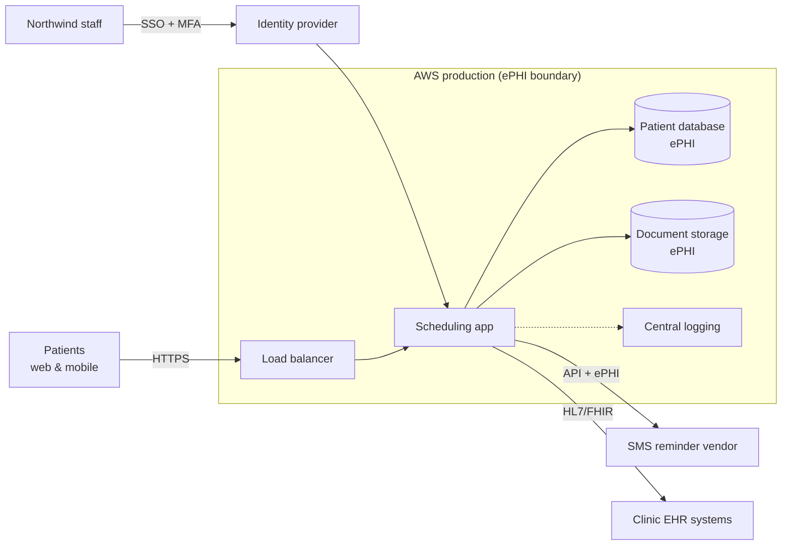

# 🛡️ HIPAA Security Risk Assessment: Northwind Health

> **Portfolio project.** Northwind Health is a **fictional** company created for this assessment. All data, systems, and findings are illustrative.

## Overview

A full information security risk assessment for **Northwind Health**, a 120-person US healthcare SaaS company whose patient scheduling platform stores electronic protected health information (ePHI).

Under the HIPAA Security Rule, organizations handling ePHI must conduct an accurate and thorough risk analysis (45 CFR §164.308(a)(1)(ii)(A)) and implement measures to reduce those risks. This project does exactly that: it identifies assets, threats, and vulnerabilities, scores each risk, and produces a prioritized treatment plan and an executive summary for leadership.

**Why I built this:** risk assessments and risk registers appear in almost every entry-level GRC job description I reviewed. I wanted proof that I can run one end to end, not just describe it. See [how this project maps to real job requirements](docs/06-job-requirements-map.md).

## Key Findings

| Rating | Count | Headline |
|---|---|---|
| 🔴 Critical | 1 | Phishing-led account takeover (MFA not enforced for all staff) |
| 🟠 High | 6 | Excessive ePHI access, cloud misconfiguration, untested backups, missing vendor BAA, limited monitoring, delayed offboarding |
| 🟡 Medium | 3 | Unencrypted laptops, unpatched libraries, untested incident response plan |
| 🟢 Low | 1 | Physical office access (formally accepted) |

**Top priority:** enforce phishing-resistant MFA for all workforce accounts within 30 days. It reduces the only Critical risk from 20 to 8.

## Architecture

Full data flow and trust boundaries: [docs/03-data-flow.md](docs/03-data-flow.md)

## Project Structure

| File | What it shows |
|---|---|
| [01 Scope & context](docs/01-scope-and-context.md) | The company, what's in scope, and regulatory drivers |
| [02 Methodology](docs/02-methodology.md) | How risks were identified and scored (NIST SP 800-30 aligned) |
| [03 Data flow](docs/03-data-flow.md) | Where ePHI lives and moves, with trust boundaries |
| [Risk register](risk-register/risk-register.md) | All 11 risks, scored and mapped to NIST CSF 2.0, HIPAA, and SOC 2 ([CSV](risk-register/risk-register.csv)) |
| [04 Treatment plan](docs/04-treatment-plan.md) | Prioritized remediation with owners and timelines |
| [05 Executive summary](docs/05-executive-summary.md) | One-page, jargon-free briefing for leadership |
| [06 Job requirements map](docs/06-job-requirements-map.md) | Which job requirement each file proves |

## Frameworks Used

- **NIST SP 800-30 Rev. 1**: risk assessment process
- **NIST CSF 2.0**: control mapping (Govern, Identify, Protect, Detect, Respond, Recover)
- **HIPAA Security Rule**: regulatory requirements for ePHI
- **SOC 2 Trust Services Criteria**: mapping for customer assurance

## What I Learned

- **Scoring needs a written rule, not a gut feeling.** My first pass rated almost everything "High." Writing down exactly what a 4 versus a 5 means for likelihood and impact forced me to justify each score, and the register became far more useful.
- **The business context changes the rating.** The same missing MFA would be a Medium in a company with no sensitive data. With ePHI and HIPAA breach notification obligations, it's Critical.
- **Leadership doesn't want the register.** They want three things: what could go wrong, what it would cost us, and what we need them to approve. The executive summary took longer to write than the register.

## What I'd Improve

- Add **quantitative analysis (FAIR)** for the top three risks, so impact is expressed as an estimated dollar range rather than a 1-5 score
- Build a **vendor risk questionnaire** and assess all four third parties, not just the SMS vendor
- Run a **tabletop exercise** against the incident response plan and document the lessons
- Automate evidence collection (e.g. scripted MFA and access-review reports) so the register stays current instead of becoming a point-in-time snapshot

## Tools

Markdown · Mermaid · Excel/CSV · NIST SP 800-30 · NIST CSF 2.0 · HIPAA Security Rule
