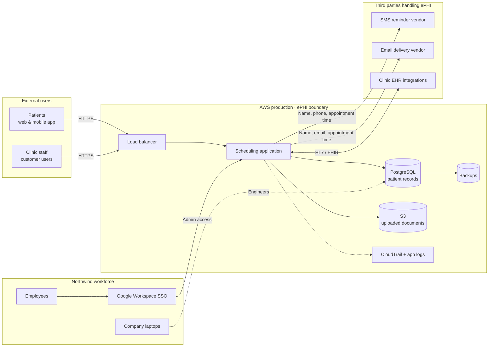

# 03 · Data Flow & Trust Boundaries

Understanding **where ePHI lives and moves** is the foundation of the assessment. Every risk in the register connects to a point on this diagram.

## Where ePHI Is Stored

| Location | Data | Encryption at rest |
|---|---|---|
| PostgreSQL (RDS) | Full patient records | ✅ Yes |
| S3 document storage | Insurance cards, referral letters | ✅ Yes (default) |
| Backups | Database snapshots | ✅ Yes |
| Employee laptops | Occasional CSV exports for support | ⚠️ Not on all devices (see R-07) |

## Where ePHI Leaves Northwind

| Recipient | Data shared | BAA in place? |
|---|---|---|
| SMS reminder vendor | Name, phone, appointment time | ❌ **No** (see R-04) |
| Email delivery vendor | Name, email, appointment time | ✅ Yes |
| Clinic EHR integrations | Appointment and patient demographics | ✅ Covered by customer agreements |

## Trust Boundaries

1. **Internet → AWS production**: patients and clinic users
2. **Workforce → production**: admin and engineer access (highest-privilege path)
3. **AWS → third parties**: ePHI leaving Northwind's direct control
